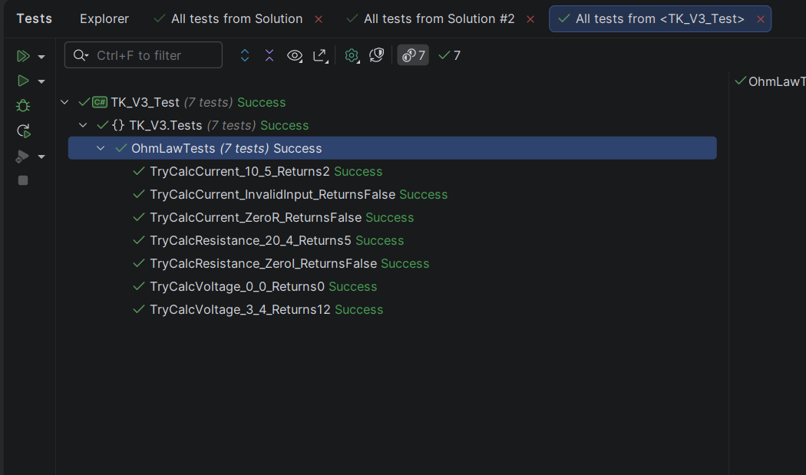

# Практическая работа — Применение закона Ома

## Информация
- Зевакин Д.С.
- Группа 3ИСИП323
- Вариант: 3

## Описание
Avalonia UI приложение для вычисления силы тока, напряжения или сопротивления электрической цепи по закону Ома:
- I = U / R (сила тока)
- U = I × R (напряжение)
- R = U / I (сопротивление)

При выборе переключателя (RadioButton) меняются подписи полей ввода. Результат отображается после нажатия кнопки «Вычислить». Реализована валидация ввода и обработка деления на ноль.

## Структура проекта
- `TK_V3/` — Avalonia UI приложение
- `TK_V3.Tests/` — MSTest автоматизированные тесты (8 шт.)
- `TestScenarios.docx` — тестовые сценарии

## Запуск
```
dotnet run --project TK_V3
```

## Запуск тестов
```
dotnet test TK_V3_Test
```

## Скриншот обозревателя тестов
